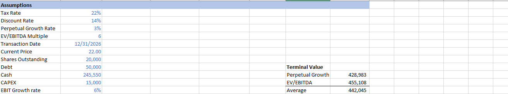
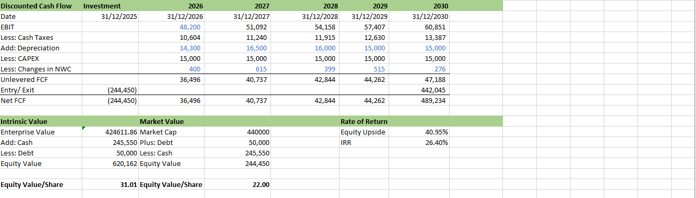

# DCF-model

A basic Discounted Cash Flow valuation model.

## Model Overview

This DCF model calculates the intrinsic value of a company using Unlevered Free Cash Flow projections and a terminal value.

### Key Components
- Unlevered Free Cash Flow forecast (2026–2030)
- Terminal Value (Perpetual Growth + EV/EBITDA methods)
- Enterprise Value and Equity Value calculation
- Implied share price and upside/(downside)

## Assumptions

Key assumptions used in the model:

- Tax Rate: 22%
- Discount Rate (WACC): 14%
- Perpetual Growth Rate: 3%
- EV/EBITDA Multiple: 6x
- EBIT Growth Rate: 6%

## DCF Output

### Key Results
- Enterprise Value: ~424,612
- Equity Value: ~620,162
- Implied Share Price: 31.01
- Current Share Price: 22.00
- Equity Upside: 40.95%
- IRR: 26.40%

## Notes
This model was originally built as part of structured financial modeling training and later independently rebuilt multiple times.
